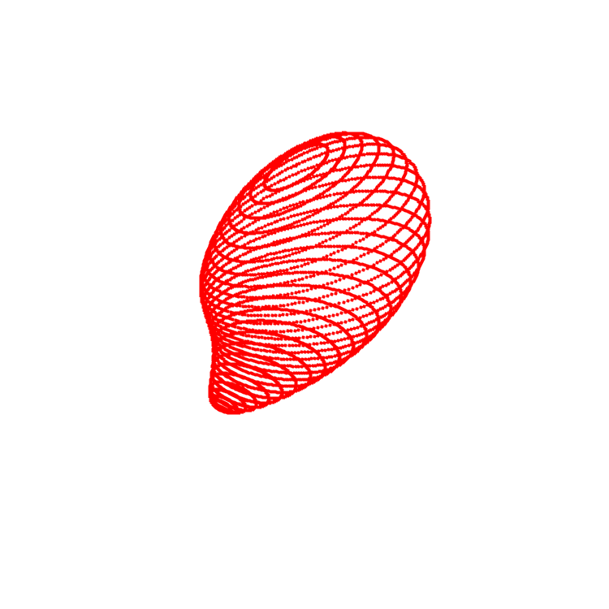

# Abstract 3D Single Limb Shapes

MATLAB code for generating simple, parametric 3D "limb" stimuli: curved tubes whose cross-sections are irregular, sometimes concave polygons. Each shape is defined by a few interpretable parameters (axis curvature, cross-section complexity, twist, thickness profile), so shape properties can be varied independently or randomized. Shapes can be rendered alone or placed on a bumpy ground plane with floating "snow" particles for extra 3D context cues.

<p align="center"></p>
<p align="center"><em>Twenty random shapes from <code>gen_shape</code>, varying in curvature, thickness, twist, cross-section complexity, colour and gloss.</em></p>

## Quick start

Run everything from the repository root (the code loads `dep/grid.png` and `dep/OpenSimplex.jar` via relative paths, and `dep/` is expected on the MATLAB path).

Generate a random shape and display it:

```matlab
disp_shape(gca, gen_shape, 0, 0);
```

Or generate a full stimulus (shape + environment + snow) and choose what to draw:

```matlab
stim = gen_stim(1, 1);          % doEnv = 1, doSnow = 1
dispProps.shape = 1;
dispProps.axis  = 0;
dispProps.env   = 1;
dispProps.snow  = 1;
disp_stim(gca, stim, dispProps)
```

<table align="center">
<tr>
<td align="center"><br><sub>Shape + environment</sub></td>
<td align="center"><br><sub>Shape + environment + snow</sub></td>
</tr>
</table>

## How a shape is built

A shape is a 2D cross-section swept along a curved medial axis:

1. **Medial axis** — a circular arc of length `maLen` and curvature `maCurv`, sampled at 31 points.
2. **Cross-section** — a random closed outline (`dep/gen_shape_2d.m`) built from a perturbed circle and smoothed with a cubic B-spline. `surfComp` sets how irregular it is.
3. **Sweep** — at each axis point the cross-section is twisted, scaled by a radius profile that tapers to zero at both ends, rotated perpendicular to the axis, and placed on the axis.
4. **Mesh** — rings are joined into a triangle mesh, then scaled, rotated and positioned in space and optionally smoothed.

<table align="center">
<tr>
<td align="center"><br><sub>Cross-section rings (<code>shape.vert</code>)</sub></td>
<td align="center"><br><sub>Rings with the medial axis (<code>shape.axis</code>)</sub></td>
<td align="center"><br><sub>Vertices joined into triangles (<code>shape.face</code>)</sub></td>
</tr>
</table>

## Parameters

Pass these to `gen_shape` (or through `gen_stim`) as name/value pairs. Anything you don't specify is drawn at random.

```matlab
shape = gen_shape([], 'maCurv', 0.8, 'surfComp', 0.2, 'surfTwist', pi/2);
stim  = gen_stim(0, 0, 'maCurv', 0.8);     % same options via gen_stim
```

| Parameter | Meaning | Allowed range |
|---|---|---|
| `maCurv` | Curvature of the medial axis (0 = straight) | 0–2 |
| `maLen` | Length of the medial axis | 1–4 |
| `maJunc` | `[x y z]` point to attach the axis start to (for joining limbs) | `[]` = unused |
| `surfComp` | Cross-section complexity: more lumps and concavities | 0–1 |
| `surfTwist` | Total twist of the cross-section along the axis (rad) | 0–π |
| `surfThkns` | Three interior width values of the thickness profile | 1×3, roughly 0.1–0.7 |
| `surfProf` | Explicit `[x-radius y-radius]` profile, overrides `surfThkns` | N×2, N = 31 |
| `surfSmooth` | Smooth the final mesh | `true` / `false` |
| `stimColor` | Surface RGB colour (see `getColor`) | 1×3 |
| `stimGloss` | Specular strength | 0–1 |
| `stimSize` | Overall scale | 0–1 |
| `stimOri` | `[rx ry rz]` rotation applied to the finished shape (rad) | 1×3 |
| `stimPos` | `[x y z]` position | 1×3 |

<p align="center"><a href="https://www.nature.com/articles/s41467-026-74818-y"></a></p>
<p align="center"><em>Supplementary Figure 1 from <a href="https://doi.org/10.1038/s41467-026-74818-y">Srinath et al. (2026)</a>. (A) A random 2D cross-section is stacked along a curved medial axis, scaled by a thickness profile. (B) Ranges and examples of each parameter. (C) Lighting and rendering. (D) The shape colour palette.</em></p>

## Output format

`gen_stim` returns a struct:

| Field | Contents |
|---|---|
| `stim.shape` | `vert` (V×3), `face` (F×3), `axis` (medial axis in final coordinates), `params` |
| `stim.env` | Ground-plane height map (`xx`, `yy`, `zz`, `params`), or `[]` |
| `stim.snow` | Snow point coordinates and sizes, or `[]` |

## Display options

`disp_stim(h, stim, dispProps)` takes 0/1 flags:

| Flag | Effect |
|---|---|
| `shape` | Draw the limb |
| `axis` | Overlay the medial axis in red and make the surface semi-transparent |
| `env` | Draw the grid-textured ground plane; the shape is placed on it |
| `snow` | Draw floating particles |

## Repository layout

| Path | Purpose |
|---|---|
| `gen_stim.m` | Top-level entry point: shape + optional environment and snow |
| `gen_shape.m` | 3D limb generation (axis, radius profile, sweep, mesh) |
| `gen_env.m` | Bumpy ground plane from OpenSimplex noise |
| `gen_snow.m` | Sparse random 3D points |
| `disp_stim.m`, `disp_shape.m`, `disp_env.m` | Rendering (patch/surface, lighting, perspective camera) |
| `dep/gen_shape_2d.m` | Random 2D cross-section outline |
| `dep/checkPolygon.m` | Rejects self-intersecting outlines |
| `dep/getColor.m` | 27-colour palette |
| `dep/movePts.m` | 2D rotate/scale/translate helper |
| `dep/OpenSimplex*.jar`, `dep/grid*.png` | Noise library and ground texture |
| `export/face_31.txt` | Cached mesh face indices for a 31-point axis (auto-generated; delete if the axis point count or cross-section sampling changes) |

## Requirements

- MATLAB with the Curve Fitting Toolbox (`spmak`, `fnval`) and Image Processing Toolbox (`warp` texture mapping).
- The [geom2d toolbox](https://www.mathworks.com/matlabcentral/fileexchange/7844-geom2d) (provides `polygonSelfIntersections`, used by `dep/checkPolygon.m`). It is not included in this repo: download it (e.g. into `dep/geom2d`) and add it to the MATLAB path.
- Java enabled in MATLAB (for the OpenSimplex noise library).

## Citation

If you use these stimuli or this code, please cite:

> Srinath, R., Czarnik, M.M. & Cohen, M.R. Stable readout of visual representations mediates flexible generalization. *Nat Commun* **17**, 7914 (2026). https://doi.org/10.1038/s41467-026-74818-y
